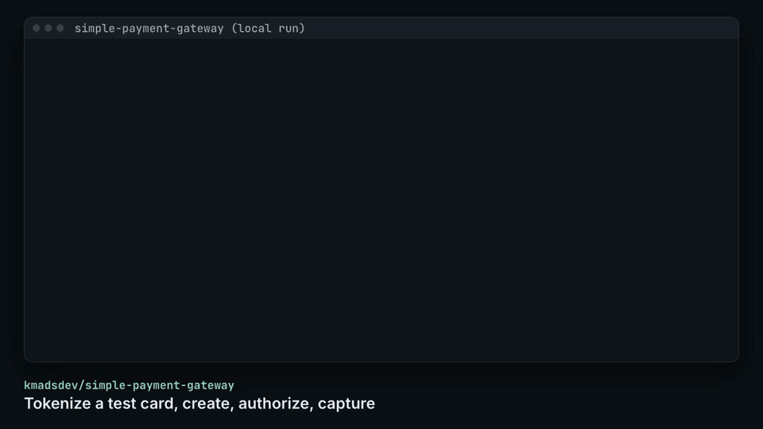
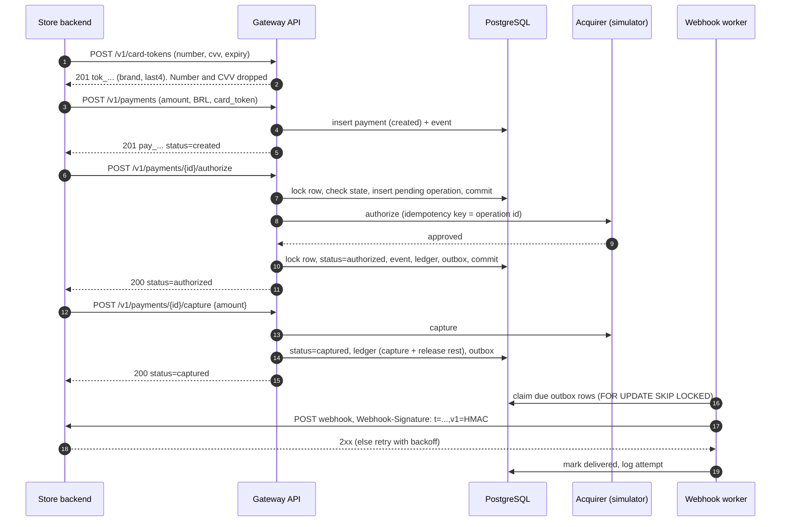
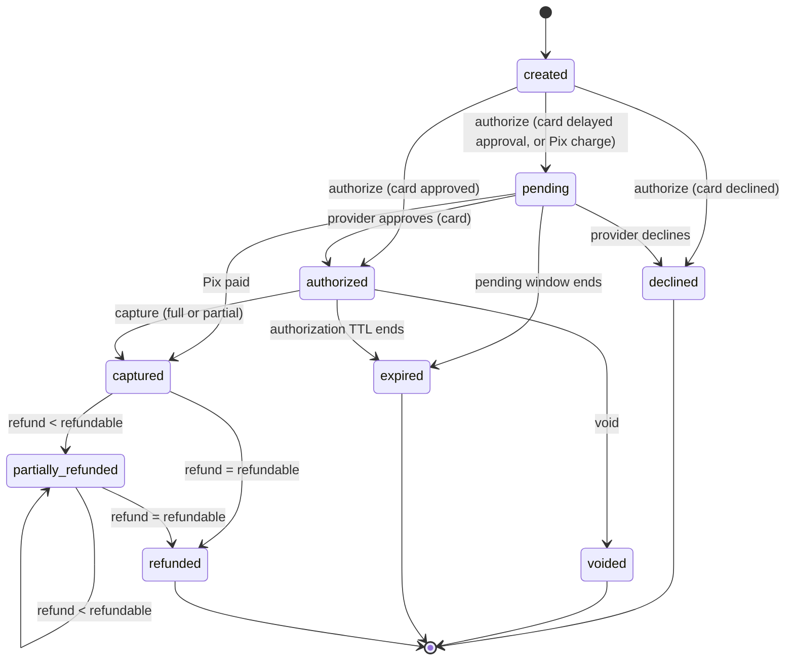

# simple-payment-gateway

A study project: a payment gateway for an online store, in Go and PostgreSQL. All payments are simulated. No real money moves, no real acquirer or PSP is called, and the card numbers are test numbers.

[Leia em português](README.pt-br.md)



*Local run of the README walkthrough.*

## What it does

The store (the merchant) calls a REST API from its backend at checkout time. There is no frontend.

- **Merchant auth.** Each store has an API key. I store only its SHA-256 hash and compare in constant time. The plaintext key is printed once, at creation. Each merchant has its own rate limit.
- **Payment lifecycle.** `create -> authorize -> capture (full or partial) -> refund (full or partial)`, plus `void` before capture and automatic expiry of uncaptured authorizations. An explicit state machine rejects illegal moves with `409`.
- **Card and Pix.** Cards are tokenized: I validate the number (Luhn), keep only a token, a brand guess and the last 4 digits, and drop the number and the CVV. Pix gets a simulated copy-and-paste payload with an expiry, and a simulator endpoint marks it paid.
- **Idempotency.** Every mutating endpoint needs an `Idempotency-Key`. A retry with the same body replays the stored response. A reused key with a different body gets `422`.
- **Consistency.** Every state change runs in one database transaction with a row lock. It writes the new state, an append-only event, double-entry ledger lines that sum to zero, and an outbox message.
- **Webhooks.** A transactional outbox and a worker deliver events with retries, exponential backoff with jitter, and an HMAC-SHA256 signature with a timestamp. Each attempt is logged.
- **Resilience.** Timeouts and context cancellation on every call, retries with an attempt and time budget, a circuit breaker toward the provider, and graceful shutdown.
- **Operations.** JSON logs (`slog`) with a request id, Prometheus metrics, health and readiness probes, an OpenAPI 3 spec checked in CI, and RFC 7807 errors.

## Why Go for a gateway

- A gateway spends most of its time waiting on I/O: the database, the provider, the merchant's webhook endpoint. Goroutines and `context.Context` make "wait on many things, cancel all of them at a deadline" the normal way to write code, not a special case.
- The standard library covers most of the job: `net/http` with method and path patterns, `log/slog`, `crypto/hmac`, `crypto/subtle`, `database/sql`. The service has three direct runtime dependencies: `pgx`, `goose` and the Prometheus client.
- One static binary in a 6 MB distroless image, non-root, fast to start. That fits rolling deploys and graceful shutdown.
- The race detector runs on every test in CI, which matters for code that is about concurrency (idempotency races, concurrent refunds, outbox workers).

## Architecture

```
cmd/gateway            entry point: serve, migrate, create-merchant, healthcheck
internal/payment       domain: state machine, ledger journals, invariants (no I/O)
internal/money         Amount type (int64 minor units), decimal format and parse
internal/card          Luhn, brand guess, CVV and expiry checks
internal/pix           simulated Pix payload (EMV-style TLV + CRC16)
internal/acquirer      provider port, deterministic simulator, resilience decorator
internal/resilience    backoff with jitter, retry with budget, circuit breaker
internal/service       use cases, three-phase provider calls, background maintenance
internal/store         PostgreSQL with pgx: payments, ledger, idempotency, outbox
internal/webhook       signing and the outbox dispatcher
internal/httpapi       routes, middleware, handlers, RFC 7807 problems
internal/observability slog setup with request id, Prometheus metrics
migrations             SQL migrations (goose), embedded in the binary
api/openapi.yaml       API contract
examples/              webhook receiver that verifies signatures
docs/adr/              design decisions
```

The domain package has no I/O. Each operation (for example `Capture(amount)`) changes the payment value and returns a `Transition` with the ledger journals. The store writes that result in one transaction. This keeps the rules testable without a database, and the database tests check that the stored result matches.

## Checkout flow



No database lock is held while the provider call runs. Phase 1 inserts a `pending` operation row, and a partial unique index allows only one in-flight operation per payment. Phase 3 locks the row again and applies the result. See [ADR 0006](docs/adr/0006-three-phase-provider-calls.md).

## State machine



Rules on top of the diagram: one capture per payment, and a partial capture releases the rest of the hold. Refunds can be many, and their sum never goes above the captured amount. Pix has no capture step.

## Ledger

Every payment has three ledger accounts. A debit is positive, a credit is negative, and each journal sums to zero.

| Journal   | Debit (+)  | Credit (-) | When                                    |
|-----------|------------|------------|-----------------------------------------|
| authorize | `hold`     | `customer` | card approved, or Pix paid              |
| capture   | `merchant` | `hold`     | capture, or Pix paid                    |
| release   | `customer` | `hold`     | void, expiry, rest of a partial capture |
| refund    | `customer` | `merchant` | refund                                  |

Invariants, checked in tests after random operation sequences: the sum of all lines is zero; `hold` equals the authorized amount while the status is `authorized` and zero otherwise; `merchant` equals captured minus refunded; and `0 <= refunded <= captured <= authorized <= amount`. The database enforces part of this too: append-only triggers on `ledger_entries` and `payment_events`, a deferred trigger that rejects an unbalanced journal at commit, and check constraints on the amounts.

## Run it

Needs Docker. Go 1.27 is only needed to run the tests outside Docker.

```sh
docker compose up -d --build        # postgres, gateway on :8080, webhook receiver
docker compose run --rm gateway create-merchant \
  --name "Demo Store" --webhook-url http://webhook-receiver:8081/webhooks
```

The last command prints `merchant_id`, `api_key` and `webhook_secret` once. The compose file sets a dev-only webhook secret so the example receiver can verify signatures. Every credential in `docker-compose.yml` is a local default for this study setup.

Tests:

```sh
make test-docker   # all tests, race detector on, throwaway Postgres in Docker
make test          # same, with your own DATABASE_URL and a local Go toolchain
make lint          # golangci-lint, same version as CI
make fuzz          # each fuzz target for 20 seconds
```

`docker compose down -v` stops everything and deletes the data.

## curl walkthrough: a purchase and a refund

```sh
export KEY=sk_test_...                    # from create-merchant
export B=http://localhost:8080
```

1. Tokenize the card. The response has no card number.

```sh
curl -s -X POST $B/v1/card-tokens -H "Authorization: Bearer $KEY" \
  -H "Idempotency-Key: tok-1" \
  -d '{"number":"4111 1111 1111 1111","cvv":"123","exp_month":12,"exp_year":2030}'
```
```json
{"id":"tok_137136f3b26322587b0a","object":"card_token","brand":"visa","last4":"1111","exp_month":12,"exp_year":2030,"created_at":"2026-11-13T06:52:27.760382Z"}
```

2. Create the payment for order 1001: R$ 159,90 is `15990` centavos.

```sh
curl -s -X POST $B/v1/payments -H "Authorization: Bearer $KEY" \
  -H "Idempotency-Key: order-1001" \
  -d '{"amount":15990,"currency":"BRL","method":"card","card_token":"tok_137136f3b26322587b0a","reference":"order-1001"}'
```
```json
{"id":"pay_e6a34b0457c29458068e","object":"payment","status":"created","method":"card","amount":15990,"currency":"BRL","authorized_amount":0,"captured_amount":0,"refunded_amount":0,"card":{"brand":"visa","last4":"1111"},"reference":"order-1001", "...": "..."}
```

3. Authorize, then capture R$ 150,00 (one item went out of stock). The other R$ 9,90 of the hold is released.

```sh
curl -s -X POST $B/v1/payments/pay_e6a34b0457c29458068e/authorize \
  -H "Authorization: Bearer $KEY" -H "Idempotency-Key: auth-1001"
# {"status":"authorized","authorized_amount":15990, ...}

curl -s -X POST $B/v1/payments/pay_e6a34b0457c29458068e/capture \
  -H "Authorization: Bearer $KEY" -H "Idempotency-Key: cap-1001" -d '{"amount":15000}'
# {"status":"captured","captured_amount":15000, ...}
```

4. The customer returns an item: refund R$ 50,00. A refund above what is left fails.

```sh
curl -s -X POST $B/v1/payments/pay_e6a34b0457c29458068e/refunds \
  -H "Authorization: Bearer $KEY" -H "Idempotency-Key: ref-1001-a" -d '{"amount":5000}'
# {"status":"partially_refunded","refunded_amount":5000, ...}

curl -s -X POST $B/v1/payments/pay_e6a34b0457c29458068e/refunds \
  -H "Authorization: Bearer $KEY" -H "Idempotency-Key: ref-1001-b" -d '{"amount":20000}'
```
```json
{"type":"https://github.com/kmadsdev/simple-payment-gateway/blob/main/docs/errors.md#amount_too_high","title":"Amount above the allowed limit","status":422,"detail":"amount above the allowed limit: refund 20000 above refundable 10000 (minor units)","instance":"/v1/payments/pay_e6a34b0457c29458068e/refunds","code":"amount_too_high","request_id":"req_..."}
```

5. A network retry of step 4 with the same key does not refund twice. It replays the first answer.

```sh
curl -s -i -X POST $B/v1/payments/pay_e6a34b0457c29458068e/refunds \
  -H "Authorization: Bearer $KEY" -H "Idempotency-Key: ref-1001-a" -d '{"amount":5000}'
# HTTP/1.1 200 OK
# Idempotent-Replayed: true
```

6. Read the ledger. The lines sum to zero.

```sh
curl -s $B/v1/payments/pay_e6a34b0457c29458068e/ledger -H "Authorization: Bearer $KEY"
```
```text
authorize  hold      +15990    authorize  customer  -15990
capture    merchant  +15000    capture    hold      -15000
release    customer    +990    release    hold        -990
refund     customer   +5000    refund     merchant   -5000
```

7. The receiver got one signed webhook per transition: `docker compose logs webhook-receiver`.

```text
"msg":"webhook received","type":"payment.authorized"
"msg":"webhook received","type":"payment.captured"
"msg":"webhook received","type":"payment.partially_refunded"
```

### Pix

```sh
curl -s -X POST $B/v1/payments -H "Authorization: Bearer $KEY" -H "Idempotency-Key: order-1002" \
  -d '{"amount":4990,"currency":"BRL","method":"pix"}'
curl -s -X POST $B/v1/payments/<id>/authorize -H "Authorization: Bearer $KEY" -H "Idempotency-Key: auth-1002"
# {"status":"pending","pix":{"copy_paste":"00020126420021example.simulated.pix...6304CCD4","expires_at":"..."}}
curl -s -X POST $B/v1/simulator/payments/<id>/pix-paid -H "Authorization: Bearer $KEY" -H "Idempotency-Key: paid-1002"
# {"status":"captured","captured_amount":4990, ...}
```

The payload marks itself as `example.simulated.pix`. No bank app accepts it.

## Simulator magic values

The simulator is deterministic, so every path can be triggered on purpose (card payments only):

| Trigger                       | Example amount | Result                                         |
|-------------------------------|----------------|------------------------------------------------|
| cents `51`                    | `1051`         | declined, `insufficient_funds`                 |
| cents `05`                    | `1005`         | declined, `do_not_honor`                       |
| card ending `0002`            | any            | declined, `card_declined` (`4000000000000002`) |
| cents `91`                    | `1091`         | every attempt times out: `503 provider_unavailable`, payment unchanged |
| cents `92`                    | `1092`         | first attempt times out, the retry is approved |
| cents `93`                    | `1093`         | `pending`, approved after `SIM_DELAYED_APPROVAL` (5s) |
| anything else                 | `15990`        | approved                                       |

## Design decisions

Each one has an ADR in [docs/adr](docs/adr/) with the context and the trade-offs.

| ADR | Decision |
|-----|----------|
| [0001](docs/adr/0001-go-and-standard-library.md) | Go, `net/http` patterns, few dependencies |
| [0002](docs/adr/0002-plain-pgx-and-goose.md) | Plain `pgx` with hand-written SQL, goose migrations |
| [0003](docs/adr/0003-money-as-integer-minor-units.md) | Money as `int64` centavos, a test bans floats |
| [0004](docs/adr/0004-state-machine-events-and-ledger.md) | Explicit state machine, append-only events, double-entry ledger |
| [0005](docs/adr/0005-idempotency-keys.md) | Idempotency keys stored with request hash and response |
| [0006](docs/adr/0006-three-phase-provider-calls.md) | No database lock during provider calls |
| [0007](docs/adr/0007-acquirer-port-and-simulator.md) | Provider port, deterministic simulator, retry budget and circuit breaker |
| [0008](docs/adr/0008-card-data-and-secrets.md) | What card data and secrets I store, and how |
| [0009](docs/adr/0009-webhooks-outbox.md) | Webhooks through a transactional outbox, signed, at least once |
| [0010](docs/adr/0010-rate-limiting.md) | Per-merchant GCRA rate limit in memory |
| [0011](docs/adr/0011-integration-tests-with-real-postgres.md) | Integration tests against a real PostgreSQL |

## Tests

- Table-driven unit tests for the state machine, the ledger journals, money, Luhn, Pix payload, backoff, retry and breaker.
- A random-sequence test runs 2,000 payments through random operations in memory, and another runs random sequences through the service against PostgreSQL. Both check the ledger invariants after every step.
- Concurrency against real PostgreSQL: two goroutines send the same request with the same `Idempotency-Key` (20 rounds, exactly one payment per key), and 12 goroutines refund the same payment at once (the refunded total never passes the captured amount).
- A test sends real card numbers and CVVs (valid and invalid) through the HTTP API with debug logs on. It then checks that they appear in no log line, no error response, and no row of any table.
- Fuzz tests for the amount parser, Luhn, card number normalization and the Pix parser.
- Guard tests: no `float32`/`float64` or float literal in production code, no float column in migrations, the OpenAPI spec is valid, and it matches the router in both directions (also which routes need `Idempotency-Key`).
- CI runs `go vet`, `golangci-lint`, all tests with `-race` against a PostgreSQL service container (`REQUIRE_DB=1` makes a skipped integration test a failure), coverage, short fuzz runs, and the Docker build.

## Configuration

| Variable | Default | Meaning |
|----------|---------|---------|
| `DATABASE_URL` | none | PostgreSQL connection string |
| `HTTP_ADDR` | `:8080` | listen address |
| `LOG_LEVEL` | `info` | `debug`, `info`, `warn`, `error` |
| `RATE_LIMIT_RPS` / `RATE_LIMIT_BURST` | `20` / `40` | per merchant |
| `AUTHORIZATION_TTL` | `168h` | uncaptured authorization lifetime |
| `PENDING_TTL` | `30m` | Pix expiry and delayed-approval timeout |
| `ACQUIRER_ATTEMPT_TIMEOUT` / `ACQUIRER_TOTAL_BUDGET` / `ACQUIRER_MAX_ATTEMPTS` | `2s` / `5s` / `3` | retry budget toward the provider |
| `ACQUIRER_BREAKER_THRESHOLD` / `ACQUIRER_BREAKER_COOLDOWN` | `5` / `30s` | circuit breaker |
| `WEBHOOK_MAX_ATTEMPTS` / `WEBHOOK_BACKOFF_BASE` | `8` / `2s` | webhook retries |
| `SIMULATOR_ENABLED` | `true` | exposes `/v1/simulator/...` |
| `MIGRATE_ON_START` | `true` | apply migrations at startup |

## What is not built

This is a study project. These parts of a real gateway are out of scope on purpose:

- **PCI DSS scope.** I never store the card number, but the API still receives it in a request body. A real system would collect cards in a PCI-certified vault or hosted fields, with network segmentation, key management and audits.
- **Real acquirer, PSP or card network.** The only provider adapter is the in-memory simulator. Its state is lost on restart.
- **Real Pix.** No connection to the instant payment system, no DICT keys, no real BR Code. The payload is a look-alike for the flow.
- **3-D Secure** and any other cardholder authentication.
- **Antifraud** and risk scoring.
- **Settlement and reconciliation.** No settlement files, no payouts to the merchant, no fees, no chargebacks or disputes. A provider call that times out with an unknown outcome is marked as failed; a real system would reconcile it against provider reports.
- **Multi-currency, installments (parcelamento), and multiple captures per authorization.**
- **Production concerns:** secret management (KMS for the webhook secrets), a shared rate limit across replicas, and an admin API.

## License

To be decided by the owner.
