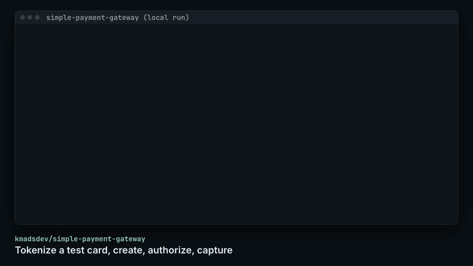
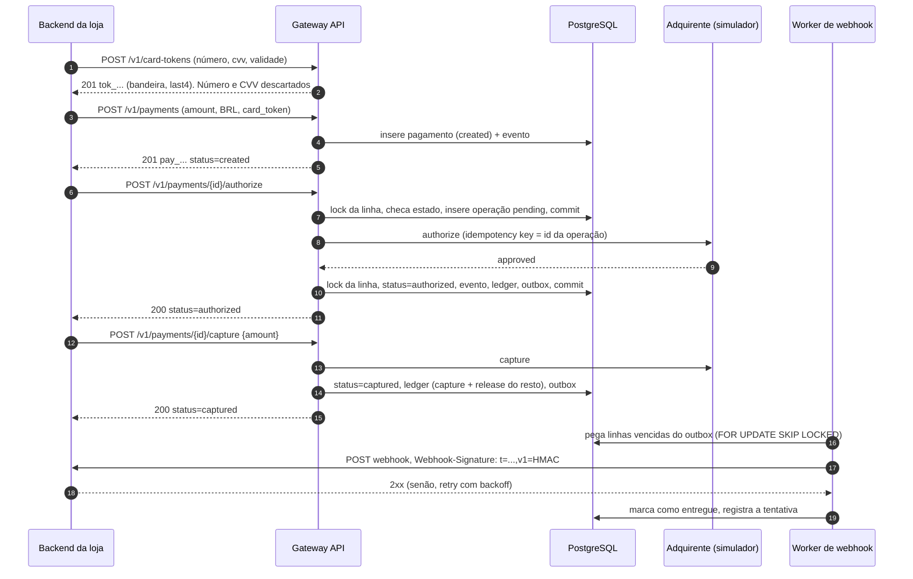
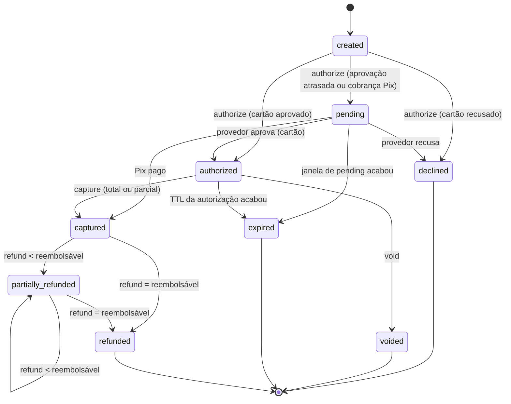

# simple-payment-gateway

Projeto de estudo: um payment gateway para uma loja online, em Go e PostgreSQL. Todos os pagamentos são simulados. Nenhum dinheiro de verdade circula, nenhum adquirente ou PSP real é chamado, e os números de cartão são de teste.

[Read in English](README.md)



*Execução local do passo a passo do README.*

## O que ele faz

A loja (o merchant) chama uma API REST a partir do backend dela, no momento do checkout. Não tem frontend.

- **Autenticação do merchant.** Cada loja tem uma API key. Eu guardo só o hash SHA-256 e comparo em tempo constante. A key em texto puro aparece uma única vez, na criação. Cada merchant tem seu próprio rate limit.
- **Ciclo de vida do pagamento.** `create -> authorize -> capture (total ou parcial) -> refund (total ou parcial)`, mais `void` antes da captura e expiração automática de autorizações não capturadas. Uma state machine explícita recusa transições ilegais com `409`.
- **Cartão e Pix.** O cartão é tokenizado: eu valido o número (Luhn), guardo só um token, um palpite da bandeira e os 4 últimos dígitos, e descarto o número e o CVV. O Pix gera um "copia e cola" simulado com expiração, e um endpoint do simulador marca como pago.
- **Idempotência.** Todo endpoint que altera estado exige `Idempotency-Key`. Um retry com o mesmo body devolve a resposta guardada. A mesma key com outro body recebe `422`.
- **Consistência.** Toda mudança de estado roda em uma transação do banco com row lock. Ela grava o novo estado, um evento append-only, lançamentos de ledger em partidas dobradas que somam zero e uma mensagem no outbox.
- **Webhooks.** Um transactional outbox e um worker entregam os eventos com retries, exponential backoff com jitter e assinatura HMAC-SHA256 com timestamp. Cada tentativa fica registrada.
- **Resiliência.** Timeouts e cancelamento por context em todas as chamadas, retries com orçamento de tentativas e de tempo, circuit breaker na frente do provedor e graceful shutdown.
- **Operação.** Logs em JSON (`slog`) com request id, métricas Prometheus, probes de health e readiness, spec OpenAPI 3 validada no CI e erros no padrão RFC 7807.

## Por que Go para um gateway

- Um gateway passa a maior parte do tempo esperando I/O: o banco, o provedor, o endpoint de webhook do merchant. Com goroutines e `context.Context`, "esperar várias coisas e cancelar todas num deadline" é o jeito normal de escrever o código, não um caso especial.
- A standard library resolve quase tudo: `net/http` com padrões de método e path, `log/slog`, `crypto/hmac`, `crypto/subtle`, `database/sql`. O serviço tem três dependências diretas em runtime: `pgx`, `goose` e o client do Prometheus.
- Um binário estático numa imagem distroless de 6 MB, sem root, que sobe rápido. Isso combina com rolling deploy e graceful shutdown.
- O race detector roda em todos os testes no CI, o que importa num código que é sobre concorrência (corrida de idempotência, refunds simultâneos, workers do outbox).

## Arquitetura

```
cmd/gateway            entrypoint: serve, migrate, create-merchant, healthcheck
internal/payment       domínio: state machine, lançamentos do ledger, invariantes (sem I/O)
internal/money         tipo Amount (int64 em centavos), formatação e parse decimal
internal/card          Luhn, palpite de bandeira, validação de CVV e validade
internal/pix           payload Pix simulado (TLV no estilo EMV + CRC16)
internal/acquirer      port do provedor, simulador determinístico, decorator de resiliência
internal/resilience    backoff com jitter, retry com orçamento, circuit breaker
internal/service       casos de uso, chamadas ao provedor em três fases, manutenção em background
internal/store         PostgreSQL com pgx: pagamentos, ledger, idempotência, outbox
internal/webhook       assinatura e o dispatcher do outbox
internal/httpapi       rotas, middleware, handlers, problems RFC 7807
internal/observability setup do slog com request id, métricas Prometheus
migrations             migrations SQL (goose), embutidas no binário
api/openapi.yaml       contrato da API
examples/              receiver de webhook que verifica a assinatura
docs/adr/              decisões de design
```

O pacote de domínio não faz I/O. Cada operação (por exemplo `Capture(amount)`) altera o pagamento e devolve uma `Transition` com os lançamentos do ledger. O store grava esse resultado numa transação só. Assim as regras são testáveis sem banco, e os testes com banco conferem que o que foi gravado bate com o domínio.

## Fluxo de checkout



Nenhum lock do banco fica aberto durante a chamada ao provedor. A fase 1 insere uma operação `pending`, e um índice único parcial permite só uma operação em andamento por pagamento. A fase 3 trava a linha de novo e aplica o resultado. Veja a [ADR 0006](docs/adr/0006-three-phase-provider-calls.md).

## State machine



Regras além do diagrama: uma captura por pagamento, e uma captura parcial libera o resto da reserva. Pode haver vários refunds, e a soma nunca passa do valor capturado. Pix não tem etapa de captura.

## Ledger

Cada pagamento tem três contas no ledger. Débito é positivo, crédito é negativo, e cada lançamento soma zero.

| Lançamento | Débito (+) | Crédito (-) | Quando                                     |
|------------|------------|-------------|--------------------------------------------|
| authorize  | `hold`     | `customer`  | cartão aprovado ou Pix pago                |
| capture    | `merchant` | `hold`      | captura ou Pix pago                        |
| release    | `customer` | `hold`      | void, expiração, resto de captura parcial  |
| refund     | `customer` | `merchant`  | refund                                     |

Invariantes, conferidas nos testes depois de sequências aleatórias de operações: a soma de todas as linhas é zero; `hold` é igual ao valor autorizado enquanto o status é `authorized` e zero nos outros casos; `merchant` é igual a capturado menos reembolsado; e `0 <= refunded <= captured <= authorized <= amount`. O banco também garante parte disso: triggers append-only em `ledger_entries` e `payment_events`, uma trigger deferred que recusa lançamento desbalanceado no commit, e check constraints nos valores.

## Como rodar

Precisa de Docker. Go 1.27 só é necessário para rodar os testes fora do Docker.

```sh
docker compose up -d --build        # postgres, gateway na :8080, receiver de webhook
docker compose run --rm gateway create-merchant \
  --name "Demo Store" --webhook-url http://webhook-receiver:8081/webhooks
```

O último comando imprime `merchant_id`, `api_key` e `webhook_secret` uma única vez. O compose define um webhook secret só de desenvolvimento para o receiver de exemplo conseguir verificar as assinaturas. Toda credencial no `docker-compose.yml` é um default local deste setup de estudo.

Testes:

```sh
make test-docker   # todos os testes, race detector ligado, Postgres descartável no Docker
make test          # o mesmo, com seu DATABASE_URL e Go instalado
make lint          # golangci-lint, mesma versão do CI
make fuzz          # cada fuzz target por 20 segundos
```

`docker compose down -v` derruba tudo e apaga os dados.

## Passo a passo com curl: uma compra e um reembolso

```sh
export KEY=sk_test_...                    # do create-merchant
export B=http://localhost:8080
```

1. Tokenize o cartão. A resposta não traz o número.

```sh
curl -s -X POST $B/v1/card-tokens -H "Authorization: Bearer $KEY" \
  -H "Idempotency-Key: tok-1" \
  -d '{"number":"4111 1111 1111 1111","cvv":"123","exp_month":12,"exp_year":2030}'
```
```json
{"id":"tok_137136f3b26322587b0a","object":"card_token","brand":"visa","last4":"1111","exp_month":12,"exp_year":2030,"created_at":"2026-11-13T06:52:27.760382Z"}
```

2. Crie o pagamento do pedido 1001: R$ 159,90 são `15990` centavos.

```sh
curl -s -X POST $B/v1/payments -H "Authorization: Bearer $KEY" \
  -H "Idempotency-Key: order-1001" \
  -d '{"amount":15990,"currency":"BRL","method":"card","card_token":"tok_137136f3b26322587b0a","reference":"order-1001"}'
```

3. Autorize e depois capture R$ 150,00 (um item acabou no estoque). Os outros R$ 9,90 da reserva são liberados.

```sh
curl -s -X POST $B/v1/payments/pay_e6a34b0457c29458068e/authorize \
  -H "Authorization: Bearer $KEY" -H "Idempotency-Key: auth-1001"
# {"status":"authorized","authorized_amount":15990, ...}

curl -s -X POST $B/v1/payments/pay_e6a34b0457c29458068e/capture \
  -H "Authorization: Bearer $KEY" -H "Idempotency-Key: cap-1001" -d '{"amount":15000}'
# {"status":"captured","captured_amount":15000, ...}
```

4. O cliente devolve um item: reembolso de R$ 50,00. Um reembolso acima do que sobrou falha.

```sh
curl -s -X POST $B/v1/payments/pay_e6a34b0457c29458068e/refunds \
  -H "Authorization: Bearer $KEY" -H "Idempotency-Key: ref-1001-a" -d '{"amount":5000}'
# {"status":"partially_refunded","refunded_amount":5000, ...}

curl -s -X POST $B/v1/payments/pay_e6a34b0457c29458068e/refunds \
  -H "Authorization: Bearer $KEY" -H "Idempotency-Key: ref-1001-b" -d '{"amount":20000}'
# 422 {"code":"amount_too_high","detail":"... refund 20000 above refundable 10000 (minor units)", ...}
```

5. Um retry de rede do passo 4 com a mesma key não reembolsa duas vezes. Ele devolve a primeira resposta.

```sh
curl -s -i -X POST $B/v1/payments/pay_e6a34b0457c29458068e/refunds \
  -H "Authorization: Bearer $KEY" -H "Idempotency-Key: ref-1001-a" -d '{"amount":5000}'
# HTTP/1.1 200 OK
# Idempotent-Replayed: true
```

6. Leia o ledger. As linhas somam zero.

```sh
curl -s $B/v1/payments/pay_e6a34b0457c29458068e/ledger -H "Authorization: Bearer $KEY"
```
```text
authorize  hold      +15990    authorize  customer  -15990
capture    merchant  +15000    capture    hold      -15000
release    customer    +990    release    hold        -990
refund     customer   +5000    refund     merchant   -5000
```

7. O receiver recebeu um webhook assinado por transição: `docker compose logs webhook-receiver`.

### Pix

```sh
curl -s -X POST $B/v1/payments -H "Authorization: Bearer $KEY" -H "Idempotency-Key: order-1002" \
  -d '{"amount":4990,"currency":"BRL","method":"pix"}'
curl -s -X POST $B/v1/payments/<id>/authorize -H "Authorization: Bearer $KEY" -H "Idempotency-Key: auth-1002"
# {"status":"pending","pix":{"copy_paste":"00020126420021example.simulated.pix...6304CCD4","expires_at":"..."}}
curl -s -X POST $B/v1/simulator/payments/<id>/pix-paid -H "Authorization: Bearer $KEY" -H "Idempotency-Key: paid-1002"
# {"status":"captured","captured_amount":4990, ...}
```

O payload se identifica como `example.simulated.pix`. Nenhum app de banco aceita.

## Valores mágicos do simulador

O simulador é determinístico, então dá para disparar cada caminho de propósito (só pagamentos com cartão):

| Gatilho                  | Exemplo  | Resultado                                        |
|--------------------------|----------|--------------------------------------------------|
| centavos `51`            | `1051`   | recusado, `insufficient_funds`                   |
| centavos `05`            | `1005`   | recusado, `do_not_honor`                         |
| cartão final `0002`      | qualquer | recusado, `card_declined` (`4000000000000002`)   |
| centavos `91`            | `1091`   | toda tentativa dá timeout: `503 provider_unavailable`, pagamento inalterado |
| centavos `92`            | `1092`   | a primeira tentativa dá timeout, o retry é aprovado |
| centavos `93`            | `1093`   | `pending`, aprovado depois de `SIM_DELAYED_APPROVAL` (5s) |
| qualquer outro           | `15990`  | aprovado                                         |

## Decisões de design

Cada uma tem uma ADR em [docs/adr](docs/adr/) com o contexto e os trade-offs (em inglês).

| ADR | Decisão |
|-----|---------|
| [0001](docs/adr/0001-go-and-standard-library.md) | Go, padrões do `net/http`, poucas dependências |
| [0002](docs/adr/0002-plain-pgx-and-goose.md) | `pgx` puro com SQL escrito à mão, migrations com goose |
| [0003](docs/adr/0003-money-as-integer-minor-units.md) | Dinheiro como `int64` em centavos, um teste proíbe float |
| [0004](docs/adr/0004-state-machine-events-and-ledger.md) | State machine explícita, eventos append-only, ledger em partidas dobradas |
| [0005](docs/adr/0005-idempotency-keys.md) | Idempotency keys guardadas com hash do request e resposta |
| [0006](docs/adr/0006-three-phase-provider-calls.md) | Nenhum lock do banco durante chamadas ao provedor |
| [0007](docs/adr/0007-acquirer-port-and-simulator.md) | Port do provedor, simulador determinístico, orçamento de retry e circuit breaker |
| [0008](docs/adr/0008-card-data-and-secrets.md) | Quais dados de cartão e segredos eu guardo, e como |
| [0009](docs/adr/0009-webhooks-outbox.md) | Webhooks via transactional outbox, assinados, at least once |
| [0010](docs/adr/0010-rate-limiting.md) | Rate limit por merchant com GCRA em memória |
| [0011](docs/adr/0011-integration-tests-with-real-postgres.md) | Testes de integração contra um PostgreSQL de verdade |

## Testes

- Testes unitários table-driven para a state machine, os lançamentos do ledger, money, Luhn, payload Pix, backoff, retry e breaker.
- Um teste de sequências aleatórias passa 2.000 pagamentos por operações aleatórias em memória, e outro roda sequências aleatórias pelo service contra o PostgreSQL. Os dois conferem as invariantes do ledger depois de cada passo.
- Concorrência contra PostgreSQL real: duas goroutines mandam o mesmo request com a mesma `Idempotency-Key` (20 rodadas, exatamente um pagamento por key), e 12 goroutines fazem refund do mesmo pagamento ao mesmo tempo (o total reembolsado nunca passa do capturado). Outros testes de corrida: uma captura contra um void (exatamente um vence), o job de expiração contra uma captura em andamento (a captura vence), e um cliente que desconecta no meio da chamada ao provedor (a chamada termina e é registrada mesmo assim).
- Isolamento entre merchants: um segundo merchant recebe `404` em todas as rotas do pagamento de outro merchant, não consegue usar o card token dele, e a mesma `Idempotency-Key` em outro merchant nunca devolve a resposta guardada do primeiro.
- Um teste manda números de cartão e CVVs (válidos e inválidos) pela API HTTP com log em debug. Depois confere que eles não aparecem em nenhuma linha de log, em nenhuma resposta de erro e em nenhuma linha de nenhuma tabela.
- Fuzz tests para o parser de valores, Luhn, normalização do número do cartão e o parser do Pix.
- Testes de guarda: nenhum `float32`/`float64` ou literal float no código de produção, nenhuma coluna float nas migrations, a spec OpenAPI é válida e bate com o router nos dois sentidos (inclusive quais rotas exigem `Idempotency-Key`).
- O CI roda `go vet`, `golangci-lint`, todos os testes com `-race` contra um service container de PostgreSQL (`REQUIRE_DB=1` faz um teste de integração pulado virar falha), coverage, fuzz curto e o build Docker.

## Configuração

As variáveis de ambiente estão na tabela do [README em inglês](README.md#configuration).

## O que não foi construído

É um projeto de estudo. Estas partes de um gateway real ficaram de fora de propósito:

- **Escopo PCI DSS.** Eu nunca guardo o número do cartão, mas a API ainda recebe esse número no body. Um sistema real coletaria o cartão num vault certificado PCI ou em hosted fields, com segmentação de rede, gestão de chaves e auditorias.
- **Adquirente, PSP ou bandeira de verdade.** O único adapter de provedor é o simulador em memória. O estado dele se perde no restart.
- **Pix de verdade.** Sem conexão com o sistema de pagamentos instantâneos, sem chaves DICT, sem BR Code real. O payload só imita o formato para o fluxo.
- **3-D Secure** e qualquer outra autenticação do portador.
- **Antifraude** e score de risco.
- **Liquidação e conciliação.** Sem arquivos de liquidação, sem repasse ao merchant, sem taxas, sem chargeback ou disputa. Uma chamada ao provedor que dá timeout com resultado desconhecido é marcada como falha; um sistema real conciliaria isso com os relatórios do provedor.
- **Multimoeda, parcelamento e várias capturas por autorização.**
- **Questões de produção:** gestão de segredos (KMS para os webhook secrets), rate limit compartilhado entre réplicas, uma API de admin e proteção contra SSRF nas URLs de webhook (faixas de IP privadas não são bloqueadas; só o operador define a URL, e redirects não são seguidos).

## Licença

A definir pelo dono.
